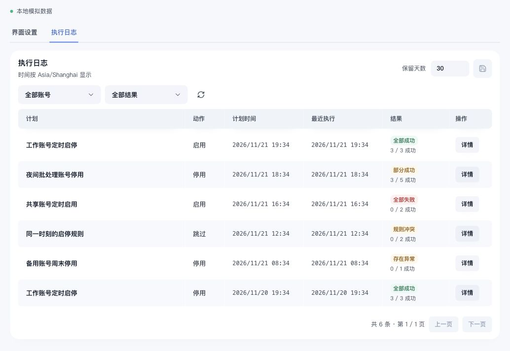
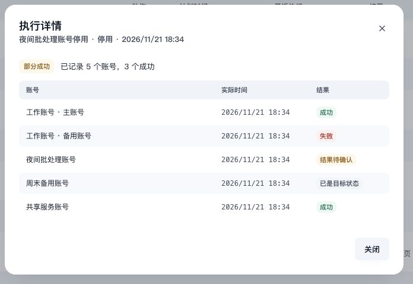

# 账号定时启停

`rs-account-scheduler` 是适用于 **codex-proxy-rs 3.54.x 和 3.55.x** 的管理插件。它可以按班次、工作日或自定义 Cron 定时启用、停用一组网关账号，并在管理界面查看每次执行结果。[codex-proxy-rs](https://github.com/zyycn/codex-proxy-rs)

## 功能

- **批量选择账号**。按账号名称、ID 或宿主账号组名搜索。列表可分页，搜索和翻页时保留勾选。RS 3.55 上的 Antigravity 账号也可加入启停计划。
- **同一计划配置启用和停用**。可选择「启用和停用」「仅启用」或「仅停用」。启用和停用各有一套执行时间，共用一组账号和一个 IANA 时区。
- **按账号错开启用**。启用抖动可自定义秒数，批量启用时分散宿主配置变更，以及 RS 可能触发的 OpenAI 模型目录补查，减轻切换瞬间的负载峰值。填 0 秒关闭抖动。
- **按星期或五段 Cron 调度**。执行时间支持可视化选择星期，也可直接填写 Cron。在按钮旁的浮层可以查看接下来五次启用或停用时间。
- **保存时检查冲突**。保存启用中的计划或重新启用计划时，比较未来 366 天的触发时刻。同一个账号在同一实际时刻会收到相反动作时，弹框会提示相关计划、账号和时间，并阻止保存。检查按各计划的时区换算。
- **按计划查看执行日志**。每次触发显示一条汇总，可按账号和结果筛选，点击「详情」查看每个账号的实际执行时间和结果。窄屏下表格可以横向滚动，详情按钮固定在右侧。

## 界面预览

以下截图使用本地模拟账号、分组和日志。

### 新建计划


### 执行日志



### 执行详情



## 安装与使用

1. 下载与 **运行宿主的服务器** 匹配的 `.tar.gz` 安装包。[Releases](https://github.com/monkeylxb/rs-account-scheduler/releases)
2. 在 codex-proxy-rs 的「系统设置 → 插件管理」上传安装包，安装并启用插件，打开「账号定时启停」。
3. 在「界面设置 → 新建计划」选择账号、执行动作和时区。配置执行时间，在启用时间设置里填写「启用抖动」的最大秒数。例如，填 30 秒时，每个账号独立抽取 0 至 30 秒的延迟。预览确认后保存。
4. 在「执行日志」查看触发记录，按需要调整日志保留天数。

| 宿主系统 | 安装包文件名后缀 |
| --- | --- |
| Linux x86_64 | `x86_64-unknown-linux-gnu.tar.gz` |
| Linux ARM64 | `aarch64-unknown-linux-gnu.tar.gz` |
| macOS ARM64（Apple 芯片） | `aarch64-apple-darwin.tar.gz` |

Linux 安装包要求 glibc 2.28 或更新版本。每个安装包都带有一个同名的 `.sha256` 校验文件。

例如，时区选择 `Asia/Shanghai`，让同一组账号在周一和周二晚上停用，到次日上午恢复。

| 动作 | 五段 Cron | 触发时间 |
| --- | --- | --- |
| 停用 | `0 22 * * 1,2` | 周一、周二 22:00 |
| 启用 | `0 8 * * 2,3` | 周二、周三 08:00 |

五段 Cron 依次填写分钟、小时、日期、月份、星期。计划列表的「下次执行」显示未来最早的触发时间，上一次的实际结果可在日志中查询。暂停计划会停止后续触发，账号维持暂停前的实际状态。

## 执行行为与数据

- 宿主约每 30 秒唤醒插件。插件计算到期计划，通过宿主账号管理接口更新账号的启用状态。大量账号到期时可能分多次唤醒处理。
- 检测到启用计划到期时，每个账号独立抽取 0 至设定秒数的延迟，并保存执行时间供重启后继续使用。预览和「下次执行」显示抖动范围，日志显示实际执行时间至秒。相近计划、批次上限和宿主负载会影响实际执行时间。
- 账号出现较新的停用动作时，覆盖尚在等待的旧启用动作。停用动作无抖动。
- 宿主停机后恢复时，每个账号以最近一次到期动作作为补执行目标。运行时若遇到同一时刻的相反动作，会跳过该账号的操作并记录「规则冲突」。
- 日志汇总基于已记录的账号结果。「已是目标状态」和「已回读确认」计入成功。尚有待处理账号时显示「执行中」。失败、冲突和回执不明确可以在详情中区分。
- 计划、待执行动作、日志和保留设置存入宿主 PostgreSQL 的插件私有状态。每个插件实例最多支持 32 条计划，每条最多 20 个账号，全部计划合计最多 160 个不同账号。
- 日志默认保留 30 天，可设为 1–365 天。最多保留 1000 条账号执行记录，达到宿主存储配额时会提前淘汰较早的记录。

旧计划默认 0 秒。回退到 v0.3.0 前，请先将启用抖动设为 0，并确认待执行队列已清空。

## 本地模拟预览

前端建议使用 Node.js 22.12+ 和 pnpm。启动后打开 `http://127.0.0.1:5177/`，页面会加载 45 个模拟账号和示例日志，刷新会恢复初始示例。

```sh
pnpm --dir frontend install --frozen-lockfile
pnpm --dir frontend dev --port 5177
```

## 测试与打包

后端使用 Rust 1.99.1+。打包使用宿主 SDK 提供的 `cpr-plugin` CLI。下面的 Linux x86_64 构建还需要 Zig 和 `cargo-zigbuild`，目标运行环境为 glibc 2.28 或更新版本。[插件 SDK 指南](https://github.com/zyycn/codex-proxy-rs/blob/main/backend/crates/gateway-plugin/sdk/README.md)

```sh
cargo test --locked --manifest-path backend/Cargo.toml
cargo build --locked --manifest-path backend/Cargo.toml
node verification/protocol-test.mjs
pnpm --dir frontend build
cargo zigbuild --locked --manifest-path backend/Cargo.toml --release --target x86_64-unknown-linux-gnu.2.28
cpr-plugin package --manifest plugin.json \
  --binary backend/target/x86_64-unknown-linux-gnu/release/account-scheduler \
  --target x86_64-unknown-linux-gnu \
  --resource-map web=frontend/dist --resource-map legal=LICENSES --output-dir dist
```

`dist/` 会生成插件归档及 `.sha256` 校验文件。版本号和宿主兼容范围见 [plugin.json](plugin.json)。

Linux ARM64 构建用 `aarch64-unknown-linux-gnu.2.28`，打包时目标为 `aarch64-unknown-linux-gnu`。在 Apple 芯片 Mac 上构建 macOS ARM64 时，用 `cargo build --locked --manifest-path backend/Cargo.toml --release --target aarch64-apple-darwin`，打包目标同为 `aarch64-apple-darwin`。

## 许可证

本项目采用 [Apache-2.0](LICENSE)。第三方组件及来源见 [LICENSES/NOTICE.md](LICENSES/NOTICE.md)。
